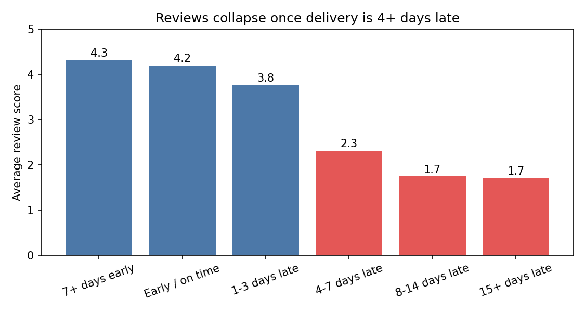
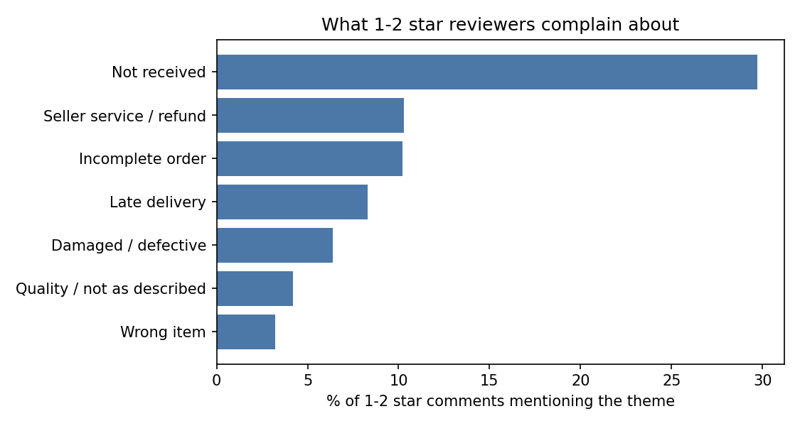

# Voice of the Customer: What Drives Bad Reviews on Olist, and What Is Fixing It Worth?

**Business question:** Which problems cause 1-2 star reviews, how much of the damage comes from delivery, and does a bad first experience actually cost repeat purchases?

**Headline findings (Olist, 98,673 reviewed orders, 2016-2018):**

1. **Delivery is the problem.** Only 8% of orders are "problem orders" (never delivered, or 4+ days later than promised), yet they produce **40% of all 1-2 star reviews**. Scoring those orders like on-time ones would lift the average review from 4.09 to 4.28.
2. **There is a cliff, not a slope.** Orders up to 3 days late still average 3.8 stars. At 4-7 days late the average drops to 2.3, and beyond a week it sits near 1.7.
3. **"Not received" dominates complaints.** About 30% of 1-2 star comments say the order never arrived, far ahead of any other theme.
4. **Perception matters too.** Of 1-2 star reviewers who complain about lateness, 40% actually received their order on or before the promised date (n=738). Expectations and tracking communication are part of the problem, not only logistics.
5. **A bad first experience did not measurably reduce repeat purchases.** 180-day repeat rate was 2.70% after a 1-2 star first order vs 2.81% after a 4-5 star one (confidence intervals overlap). Repeat buying is rare on this marketplace whatever happens, so the case for fixing delivery rests on **reviews and reputation, not on recovered repeat revenue**.




## Approach

1. **SQL** (`sql/01_review_base.sql`): joins six tables into one row per reviewed order, using window functions to keep the latest review per order and the highest-priced item's category.
2. **Delivery analysis:** days delivered vs the promised date, bucketed and compared with review scores.
3. **Complaint themes** (`src/themes.py`): a transparent Portuguese keyword/regex dictionary (accent-stripped, with a guard for phrases like "antes do prazo"), applied to the 41% of reviews that have a comment.
4. **Counterfactual:** what the average score would be if problem orders scored like normal orders.
5. **Repeat-purchase check:** customers' first delivered order before 1 Mar 2018, repeat within 180 days, by review score and by delivery lateness, with 95% confidence intervals.

## Results tables

| Theme | % of 1-2 star comments | Avg score when mentioned |
|---|---|---|
| Not received | 29.7 | 1.47 |
| Seller service / refund | 10.3 | 2.89 |
| Incomplete order | 10.2 | 1.92 |
| Late delivery | 8.3 | 2.63 |
| Damaged / defective | 6.4 | 2.14 |
| Quality / not as described | 4.2 | 3.28 |
| Wrong item | 3.2 | 1.79 |

Problem rates are highest in Maranhão (17%), Ceará (15%) and Rio de Janeiro (14%, the largest by volume). Full tables are in `reports/`.

## Limitations (read these)

- **Only 41% of reviews have a comment,** and the theme analysis covers only those.
- **Theme tagging is rule-based and imperfect.** It tags at least one theme in 61% of 1-2 star comments, so 39% are uncategorised. About 9% of 5-star comments are also tagged (mostly mild mentions). Accuracy has **not** been hand-validated: `reports/validation_sample.csv` holds 100 comments to label, and the result should be added here.
- **Correlation, not causation.** Late orders may differ in other ways (distance, product, seller).
- **"Problem order" includes unfinished orders** (shipped, cancelled, unavailable) that received a review.
- **The repeat-purchase test has limited power:** the late-delivery group has 2,868 customers and a baseline of about 3%, so a modest real effect could go undetected.
- Data is from 2016-2018, one Brazilian marketplace.

## Reproduce

1. Download the Olist dataset from Kaggle (check its licence) and place these CSVs in `data/raw/`: customers, orders, order_items, order_reviews, products, and the category translation file.
2. Run:

```bash
pip install -r requirements.txt
python src/load_data.py
python src/analyze.py
```

## Repository structure

```
sql/        01_review_base.sql
src/        load_data.py, themes.py, analyze.py
reports/    charts and result tables
```
